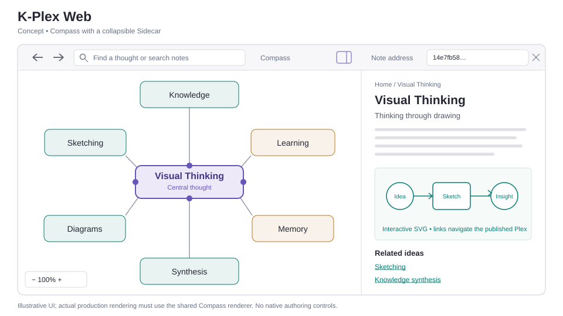
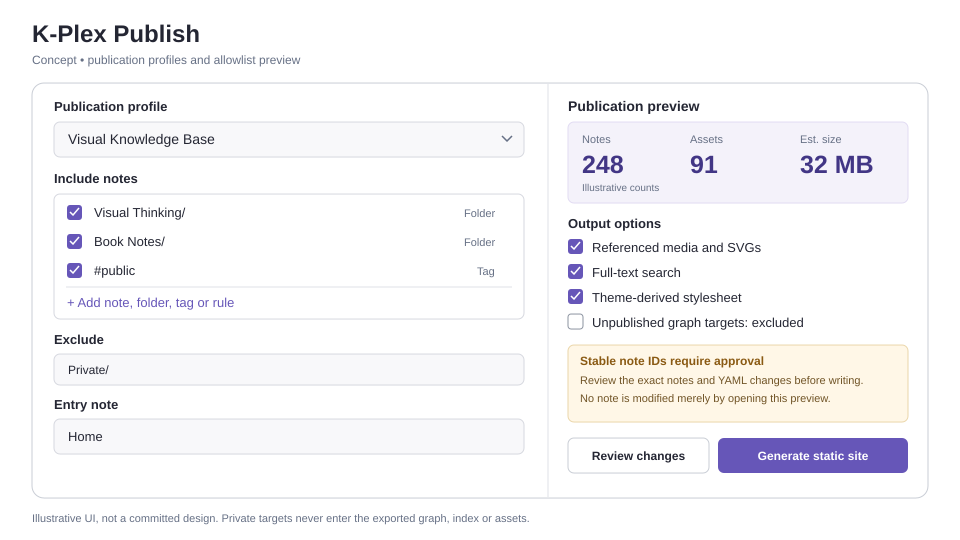

# K-Plex Publish — end-to-end static publication MVP

**Status:** specification-only draft; implementation and acceptance pending.
**Author:** Zsolt's Codex Agent.
**Accepted starting point:** main at `8d5e8a3d820f1a6e50dfb1ae9d41a18003839bd3` (merged #334 and #336).
**Tracking:** [#335](https://github.com/zsviczian/kplex/issues/335). This single PR combines the original Publication Engine and Publishing Experience milestones, including the production web reader. The [overall proposal](KPLEX_WEB_PUBLISH_PROPOSAL.md) supplies the product direction; this implementation brief supersedes its earlier PR split and packaging assumptions.

## 1. Outcome and constraints

A desktop Obsidian user can create a publication profile, select a subset of a vault, preview the exact content and proposed identity changes, explicitly consent to those changes, generate a complete static K-Plex site, and upload the resulting files to GitHub Pages or another ordinary static host. Readers can use a read-only Compass, styled thoughts and connections, search, collapsible Sidecar, shareable UUID URLs, and navigate links in notes and interactive Excalidraw SVGs. No Obsidian, database, hosted K-Plex service, server-side application, or remote runtime dependency is needed to read the publication.

The acceptance demonstration is an export of an approved disposable copy of K-Plex Help, together with a deliberately adversarial synthetic vault and a representative few-thousand-note scale fixture. Do not edit the live Help repository/vault, deploy publicly, or make bulk writes to any real user vault merely to demonstrate this feature. Use existing approved disposable destinations and synthetic data; obtain separate consent for a new vault/destination or real publication.

- Keep Compass as the only web view for MVP. Preserve all existing native views, authoring, layout, performance, indexing and stored compatibility.
- One shared renderer/projection/geometry implementation, with host-specific data and presentation adapters. Do not resume C15–C26 or rewrite PlexGraph/App to implement publishing.
- Desktop publishing first; responsive mobile and desktop readers. No automatic uploads or ongoing sync.
- Static site only, no selective reader authentication: every exported byte is public. Exclusions override inclusion. Unpublished nodes are absent, not placeholders.
- Versioned portable publication data, independent of Obsidian. Keep user documents/media licensing separate from the AGPL-3.0 runtime and its corresponding-source obligations.

## 2. Execution order and source anchors

Refresh main normally, verify branch/base and related PRs, and read AGENTS.md, CONTRIBUTING.md, CODING_STANDARDS.md, UI_RULES.md, docs/ARCHITECTURE.md, docs/AGENT_WORKFLOW.md and docs/VALIDATION_ARTIFACTS.md. Use existing test vault identities, Node version, real Obsidian typings, scanner rules, deterministic build, validation retention, localization, shared UI controls and serialized persistence owners. Record actual test commands and results in the PR and transient handoff. Keep the PR draft until acceptance; do not merge autonomously.

Implement in individually tested checkpoints in **this one branch/PR**. Each checkpoint is a reviewable commit with executable tests, not a separate PR. Reuse earlier checks and establish necessary baseline evidence before touching any shared production path. If an essential public API, privacy guarantee, or size boundary cannot be satisfied, stop at that boundary, report evidence and the narrowest viable alternative; do not silently weaken scope or add a new implementation architecture.

1. Packaging, dependency/size baseline and export contract design; prove a minimal site with the real release runtime pack.
2. Profile/selection, stable IDs, coherent graph projection, safe content conversion and deterministic staging/export.
3. Production web reader: load real publication, shared Compass, styles, HTML/interactive SVG Sidecar, search and deep links.
4. Integrated native Publish UX, consent/preview, theme generation, local export and republish.
5. End-to-end Help/scale/adversarial tests, regression and release gates.

### Mandatory UI design review and component reuse (all checkpoints)

Before designing or implementing either user interface, **open [tracking issue #335](https://github.com/zsviczian/kplex/issues/335) and actually inspect both UI concept images**, not just the issue text. The same original SVGs are embedded below beside their relevant implementation checkpoints and are available locally in `docs/proposals/assets/`. An agent without image viewing can read the SVG source and its title/description, then render the files in its local browser for visual review. Record that review in the initial implementation plan. The images communicate layout, information hierarchy and interaction intent, not pixel-exact skins, literal sample counts or final control labels. The accepted privacy/UUID consent behavior and repository UI rules take precedence; preserve the intent while adapting to native conventions and responsive widths.

**Reuse and create shared UI components is a mandatory implementation rule, not an optional cleanup.** Read [UI_RULES.md](../../UI_RULES.md), especially its shared-owner table and required visual review, and [AGENTS.md](../../AGENTS.md) (Component reuse for new UI and Plex interactions). Before adding a form, selector, toolbar, button, disclosure, review panel, list, status/progress control, or graph interaction, inspect actual existing components/hooks/styles and their consumers. In the initial UI plan, map each surface to an existing owner, a justified extension, or a new reusable component. Reusing an input alone while rebuilding its label, layout, actions and accessibility is not acceptable.

- Reuse the full native shared field/layout/footer and modal contracts (`KplexModal`, `FormSetting`/`formField`, `formActions`, `FormField`, `FormSelect`), existing native file/folder/tag selectors (including `FolderPathInput`, `KplexInputSuggest`), shared searchable picker/combobox, `Tabs`, declarative rule/condition controls, native icon/button/tooltip ownership and existing color/style controls where applicable. Inspect actual implementations rather than assuming these are interchangeable APIs.
- Where no suitable component exists, create a focused composable shared component, not a bespoke copy of another dialog. Put generic interaction/layout mechanics in `src/ui/components/`, domain-specific reusable presentation in `src/ui/features/`, and native shell/host adapters in the appropriate Obsidian layer. Reuse new components across the actual related surfaces (e.g. include/exclude rule rows, review lists, consent/status summaries), and share validation/interaction helpers with existing consumers where the need genuinely overlaps. Keep state/validation, consent, data acquisition and file writes in the owning feature/application/adapter; inject narrow data and callbacks. Do not expose native plugin objects in portable UI, invent a second design system or undertake a speculative general refactor.
- Web reader: reuse the portable SearchBox/FuzzySuggester, existing shared paint, camera/geometry and other proven host-free controls wherever appropriate. Share components when semantics genuinely match; keep native modal, editor, workspace, and browser-specific navigation effects in separate shells. Preserve existing mount/dispose and owning-window lifetimes. Do not fork shared node/gate/connector UI or imitate native Obsidian controls in a second implementation.
- Use native theme-aware control skins, consistent spacing/field widths and CTA/keyboard defaults, localized labels, accessible labels/focus, one tooltip owner, responsive wrapping, and scrollable previews. No one-off per-modal CSS skin or fixed-height layout copied from a concept image. Test all affected consumers of extended primitives.
- **Acceptance:** document reused/extended/new component owners and actual consuming surfaces, review the real native UI and web reader against the two concept images, exercise interactions/focus/draft/consent/cancellation, and capture authentic visual evidence at normal/narrow widths in light and dark themes. Include popout/owning-window and physical-device limitations as applicable. Report material deviations and rationale; a screenshot alone or a mockup resemblance without working behavior and component reuse is not acceptance. Store evidence under the existing managed validation policy, not new committed routine screenshot reports.

### Actual accepted seams to extend, not recreate

All source links are anchored to the starting revision; inspect current versions after refreshing.

- [Merged #334](https://github.com/zsviczian/kplex/pull/334) and [its validation and commands](PORTABLE_WEB_RUNTIME_V1.md): existing host-free Compass primitives and geometry, fixture demo and native comparison lanes. Its synthetic fixture is not a production schema or full appearance contract.
- [web/publication.ts](https://github.com/zsviczian/kplex/blob/8d5e8a3d820f1a6e50dfb1ae9d41a18003839bd3/src/web/publication.ts): readPublication currently accepts v1 title/entry/nodes with text and a simplified directed relationship array; hardcodes document kind/empty metadata and reconstructs inverses. Replace/extend that fixture contract for production without losing exact role-specific definitions, type, direction, or inverse semantics. Keep synthetic tests or migrate with explicit schema compatibility.
- [web/scene.ts](https://github.com/zsviczian/kplex/blob/8d5e8a3d820f1a6e50dfb1ae9d41a18003839bd3/src/web/scene.ts) and [web/Compass.tsx](https://github.com/zsviczian/kplex/blob/8d5e8a3d820f1a6e50dfb1ae9d41a18003839bd3/src/web/Compass.tsx): current fixed geometry preferences, projection maximum, simple theme, local history and plain-text note body. Extend the browser composition, not the native canvas orchestrator.
- [web/mount.tsx](https://github.com/zsviczian/kplex/blob/8d5e8a3d820f1a6e50dfb1ae9d41a18003839bd3/src/web/mount.tsx): existing mountCompass, update and dispose contract. Preserve independent instances, validation-before-replacement and cleanup.
- [PlexViewRead](https://github.com/zsviczian/kplex/blob/8d5e8a3d820f1a6e50dfb1ae9d41a18003839bd3/src/core/plex/views/contracts.ts), core graph identities and relations, and shared geometry/paint: reuse semantic contracts and actual renderer.
- [GraphIndex](https://github.com/zsviczian/kplex/blob/8d5e8a3d820f1a6e50dfb1ae9d41a18003839bd3/src/index/GraphIndex.ts), [public API](../PUBLIC_API.md), [graph adapter](https://github.com/zsviczian/kplex/blob/8d5e8a3d820f1a6e50dfb1ae9d41a18003839bd3/src/adapters/obsidian/graphContracts.ts): reuse current semantic owners and source/coverage/revision fences. Public graph queries are passive, bounded (including 200-result and work/output budgets), and may be truncated. They are NOT an exhaustive export API. Do not use a canvas snapshot or visible scene as the publication graph.
- [index/style.ts](https://github.com/zsviczian/kplex/blob/8d5e8a3d820f1a6e50dfb1ae9d41a18003839bd3/src/index/style.ts), [color presentation](https://github.com/zsviczian/kplex/blob/8d5e8a3d820f1a6e50dfb1ae9d41a18003839bd3/src/adapters/obsidian/colorPresentation.ts), [SearchBox](https://github.com/zsviczian/kplex/blob/8d5e8a3d820f1a6e50dfb1ae9d41a18003839bd3/src/ui/features/SearchBox.tsx): reuse native style resolution/precedence and portable search presentation. No new copies of style semantics, search UI, parser or graph classifier.
- [build-web-runtime.mjs](https://github.com/zsviczian/kplex/blob/8d5e8a3d820f1a6e50dfb1ae9d41a18003839bd3/scripts/build-web-runtime.mjs), [esbuild.config.mjs](https://github.com/zsviczian/kplex/blob/8d5e8a3d820f1a6e50dfb1ae9d41a18003839bd3/esbuild.config.mjs), [artifact checker](https://github.com/zsviczian/kplex/blob/8d5e8a3d820f1a6e50dfb1ae9d41a18003839bd3/scripts/testing/webRuntimeArtifacts.mjs): separate browser entry and production localization/minification/reproducibility from #336.

## 3. Checkpoint 1 — integrated Publish and a transparent runtime pack

**Product choice for this phase:** prefer Publish as a feature of K-Plex, not a separate Obsidian plugin. #336 reduced the installable set from 5,131,561 to 4,054,721 bytes and main.js from 4,963,734 to 3,923,441 bytes; the reported headroom below the 5 MiB (5,242,880 byte) exclusive ceiling is 1,188,159 bytes (~1,160 KiB). Rebuild and measure actual refreshed main. These are reported historical artifacts, not a measurement of this branch.

Preserve deterministic esbuild/Terser/CSS and locale optimizations and the existing three-file Obsidian release contract. Keep the web bundle independently built, including its own dependencies, not a second executable React/renderer in main.js. Keep optional search/conversion dependencies lean. Do not compress/eval executable internals, fetch and execute remote code inside Obsidian, add a browser-runtime import into the native entry or undermine scanner checks.

- Prove build/pack/export compatibility and account for every dependency's license, real byte cost and scanner implications before adopting it. Extend CI to produce a reproducible versioned browser-runtime distribution/manifest (local JS/CSS/HTML assets and license/source notices). Do not publish a release or tag from this PR.
- Preferred packaging: a version-matched, locally available, independently built static runtime resource pack. Make setup straightforward: build alongside local development; ship a named official release asset with clear first-use import instructions and a safe native file picker; validate manifest/schema/runtime compatibility, safe paths, file count/sizes, required files and hashes, and retain/copy as inert data. No arbitrary URL loader, runtime eval or script execution in Obsidian. An explicitly obtained official pack may be cached locally for repeat exports, with clear upgrade/replacement UI. Hashes detect corruption, not provenance; use trusted release source and communicate that the web runtime is executable on the published site.
- Investigate whether a deterministic build-time inert export-resource mechanism can provide zero-extra-step publishing within the scanner, size and release contract without duplicating executable native code. Use only if demonstrably compliant and clearly smaller/simpler; otherwise use the local runtime pack. A complete generated site carries its own pinned local runtime, not an external CDN script; separate npm/CDN distribution later.
- Release artifact count and exact total must remain strictly below 5 MiB. Track per-file byte counts and delta against the accepted #336 baseline at each checkpoint. Preserve a proposed engineering reserve of at least 256 KiB below the hard limit; if infeasible, explain measured dependency costs and request maintainer review before consuming it or splitting out a companion plugin. #334's no-growth comparison applied to a behavior-preserving refactor; do not reuse it as a zero-byte growth requirement for an explicitly authorized new feature, nor weaken it for old regression lanes. Use the actual size checker with absolute budget plus a recorded feature delta. Normal HTTP compression of exported site assets is unrelated to installed plugin size.
- Publishing is lazy, user-triggered, cancellable; importing/initializing K-Plex or opening a Plex must not load export assets, scan a vault for IDs, prepare a publication graph or start new background work.

Document the selected packaging approach and actual sizes before proceeding; do not create a second plugin without maintainer approval. If local export needs a ZIP, prefer a small audited writer with bounded work and explicit size accounting. Do not assume a third-party library is free in the installed budget.

### Packaging implementation

The accepted main source built to 4,054,721 bytes on Node 22.22.2 (3,923,441 bytes of JavaScript, 130,951 bytes of CSS, and a 329-byte manifest). Publish is integrated and uses a separate locally imported `kplex-web-runtime-<version>.json`. The pack carries text assets, per-file SHA-256 digests, license notices and a source reference. It is inert inside Obsidian and becomes executable when copied into a static site. The runtime pack prototype was 474,489 bytes, reproduced byte-for-byte on rebuild, and ran in Chromium at the HTTP root and beneath a nested path. Obsidian still installs the original three files.

## 4. Checkpoint 2 — coherent publication engine

### 4.1 Profile and selection

Versioned JSON profile(s) stored in a vault-owned K-Plex configuration location, with stable profile/publication ID, public title, entry note, explicit note/folder/tag selection rules, supported declarative lens predicates, manual include/exclude exceptions, allowed public metadata/properties, appearance/search settings and runtime compatibility. Keep raw profile private, no tokens or credentials, no wholesale settings export. Define and document exact profile path and migration/unknown-field policy; use existing safe persistence/queue ownership and avoid generated site files under indexed notes.

Resolve explicit file/folder/tag rules (folder recursion explicit), declarative predicates with current supported property availability, and manual exceptions against authoritative captured identities. Exclusions always win. Reuse existing predicate semantics; unsupported or unknown rules are visible blockers or explicitly excluded by user action, never silently included. Do not recursively follow graph relationships to broaden the selected documents. Handle ambiguous names, same filenames, rename/deletion, tags, nested folders, repeated selections and a missing/excluded entry note. Save profile, not a hidden permanent mutation of the vault; preview has no note writes.

Distinguish selected navigable documents from asset dependencies and non-document nodes. Include only explicitly authorized public folder/tag/URL/attachment nodes under a documented selection policy, not structural inventory from the rest of the vault; exclude unresolved/private targets entirely. A dependency can be included as media without becoming a navigable thought. Show approved dependency closure (images/drawings/media and note transclusions) in preview; explicit exclusions cannot be overridden by dependency inclusion. Never add a transcluded private Markdown note merely because a public note references it; require explicit selection/consent. Cycles, depth, counts and bytes bounded; no unbounded recursion or external fetching.

### 4.2 Persistent identity (explicit two-phase consent)

Default configurable Markdown property `kplex-id` contains a UUID. Keep internal graph NodeId, durable note UUID, publication ID, and visual occurrence IDs separate. No migration of existing graph identity/cache semantics. Preserve existing valid unique UUIDs. Check duplicates across the relevant authoritative vault metadata inventory (including nonselected copies/templates) so a published UUID is not ambiguous; do not inspect private body content for UUID discovery or modify private files. Missing/invalid/conflicting IDs yield an exact local plan showing affected notes, old/new values and counts, with safe conflict choices. No writes on preview, settings open, default indexing or cancellation. UUID collisions must never silently reassign valid existing IDs; resolve explicitly or exclude conflicting notes and re-preview.

Separate the review token from actual writes: exact native TFile incarnation/path, source mtime/size or stronger content/metadata revision, profile/selection, property name and old value must still match. Guard active dirty editors and concurrent Obsidian Sync updates. Use the public FileManager.processFrontMatter with the existing native mutation/identity guards; do not regex-rewrite YAML or set whole-note text. Preserve unrelated frontmatter and content. After consent, bounded serial writes, per-file receipts, cancellation and honest partial-success recovery. Multiple file writes are not an atomic transaction; never claim rollback or blindly retry. Revalidate actual persisted UUIDs, graph/source revision and selection after metadata/index reconciliation. If consent is declined, allow explicitly removing notes that cannot be published with stable IDs or cancel; no fallback to path-derived IDs. Existing valid IDs require no write. No automatic creation of desktop URI resolver in this PR.

Non-Markdown public nodes/assets need stable opaque publication-scoped identifiers. Local profile registry may track rename with authoritative identity/known rename events; preserve assigned IDs and detect duplicates. Do not expose private paths, hash paths as stable IDs, or promise rename survival when a registry cannot establish identity. Safe filename generation independent of arbitrary source names. The same note UUID can appear in separate publications; public routing is scoped by site/manifest.

### 4.3 Authoritative graph export without disturbing indexing

Trace current eager/on-demand source owners before designing a narrowly scoped internal export read/lease. Reuse existing source acquisition, canonical role classification, evidence precedence, inference, Hidden and structural handling; no additional index, shadow graph compiler, whole-cache export or arbitrary per-pair loop over the vault. Work can be proportional to selected nodes, their necessary incident/evidence inputs and admitted dependencies; it must not traverse an entire graph repeatedly per selected node. The publication graph is a detached, bounded snapshot of the approved scope, not a second live graph.

- Capture profile, relevant appearance/configuration, semantic/source revision, file identity/stamps and selected scope membership. Require actual sufficient source authority for the selected endpoints and incoming evidence, including body-defined links, before certifying absence. Existing graph API coverage distinguishes local/cached/global; do not equate search readiness, hydration, visible geometry, or a successful bounded API read with complete export. Truncation/limits must be explicit, not treated as missing relationships.
- Prefer reuse of settled eager or current prepared scopes with revision fences. In on-demand mode acquire only through established preparation/demand owners, using bounded cancellable work, release leases on all exits, and maintain foreground priority. If complete incidence genuinely requires broader indexing, disclose the scope/cost before explicit user acceptance, use the existing owner and never switch the user's persisted indexing mode or launch a competing indexer. If unavailable, block complete publishing with actionable status; do not export a partial graph as complete.
- Enumerate exact public node IDs and all canonical admitted relation facts in coherent bounded pages/chunks using existing semantic owner, filtering both endpoints before serialization. Preserve role-specific relationType, direction, definitions, defined/inferred precedence, reciprocal/multiple roles and links, including previous/next. Do not flatten inverse roles into one generic edge. If public semantics depend on private provenance that cannot safely be disclosed, use a clearly documented fail-closed exclusion through the existing resolver/projection owner; no fabricated edge across a removed node. No raw evidence/provenance, global counts or path export. Recompute gates/counts/siblings from published graph only, never infer from invisible neighbors.
- Recheck captured stamps/settings/generation after awaits, between pages and immediately before final staging. Changes during publish make the snapshot stale: cancel/re-preview or explicitly restart; never mix revisions or claim stale graph/body matches. Separate user-confirmed UUID writes from subsequent fresh capture. Cancellable tasks must settle, restore native demand and never retain mutable host objects in portable DTOs.
- Include only allowlisted metadata required by public appearance/navigation/search, safe values and references rewritten to public IDs. Hidden/private note titles, aliases, folders, tags, IDs, custom values and relation evidence must not enter the wire format, search index, assets, CSS or manifest via default styling/serialization.

Write unit tests for role-by-role parity with canonical index, dense/large adjacency and truncation, hidden links, inverse/explicit-vs-inferred precedence, same-name notes, incomplete source state, source change/cancel/reload and eager/on-demand equivalence for a fully approved scope. Assert actual acquisition/work counts, not only final scene shape.

### 4.4 Wire format and static package

Finalize a bounded versioned publication manifest + graph schema, independently validated by publisher and browser via one shared portable contract. Extend the accepted fixture provider (do not duplicate it). Manifest includes schema/runtime compatibility, publication ID/title, entry UUID, allowed relative paths, feature flags, resource integrity information and public counts; no raw profile or private source paths. Node catalog includes public opaque ID, kind, public display name, approved aliases/tags/type/properties/asset references and resolved presentation intent; separately stored sanitized HTML body. Adjacency uses full canonical directed role records or demonstrably lossless compact representation. No relation to a nonexistent endpoint; validate duplicate IDs, role/direction/type, counts, bounds, version and cross-file consistency. Unknown versions fail clearly. Keep provider capable of bounded asynchronous resource loading for future large graphs, but do not build a server or speculative provider framework.

Proposed layout (final filenames may change if consistent with schema):

```text
site/
  index.html
  .nojekyll
  publication.json
  data/nodes.json
  data/relationships.json
  data/search-index.json       # optional
  notes/<public-id>.html
  assets/<safe-content-address>.<ext>
  theme/publication.css
  runtime/<pinned-local-web-assets>
  LICENSES/...
```

All links, imports, CSS resources and data fetches support a non-root HTTP directory; no absolute root assumptions. UUID addresses survive rename and re-export; no private vault paths in browser URLs. Self-contained site includes compatible runtime, styles, license/corresponding-source information and resources. Keep build metadata deterministic where inputs unchanged (separate optional informational timestamps from content hashes). Bounded validation, deterministic ordering, stage complete output first, manifest of owned files/hashes and error/skip summary local only. Publication must be a complete safe bundle or fail explicitly.

Default UX may export a ZIP containing the directory tree, through existing safe native download ownership, with no server/network credential and no dependency on arbitrary filesystem APIs. Extracting the ZIP yields the deployable static directory; an explicitly selected folder output is optional if a supported public host mechanism is verified. Prefer outside vault, to avoid indexing generated output. Reject unsafe paths, symlink/alias escape, collisions and unowned destination replacement; never recursively delete an arbitrary folder. Full regeneration replaces only manifest-owned generated output or generates a fresh complete ZIP. Document clean deployment/replacement so removed assets/notes do not remain on hosting. Local generation cannot retract historical Git commits, caches or prior downloads. No automatic Git/FTP deployment.

### 4.5 Content conversion, media and interactive SVG

Pre-render approved Markdown to safe static HTML with links and headings/block IDs. Support ordinary Markdown (headings, paragraphs, lists, tables, code, emphasis, links), Obsidian wikilinks and aliases, callouts, heading/block links, explicitly approved embedded notes, image/audio/video/PDF/file references. Resolve authored relative/wikilinks using source context and native metadata/link resolver rather than string matching or filename guesses; rewrite public targets to UUID URLs and approved asset paths; preserve safe fragment mapping. Unpublished/unresolved targets are noninteractive and must not expose the private destination or path; distinguish ordinary explicitly authored visible text from hidden link metadata; warn on known references to excluded notes and allow review. No claims of arbitrary secret detection/redaction. Provide explicit unsupported-syntax fallback and local report. Prefer static math/Mermaid only through safe supported conversion; no dynamic Dataview, Bases, third-party runtime execution or interactive plugin-generated content.

Investigate public Obsidian MarkdownRenderer and lifecycle against actual installed typings, including whether arbitrary plugin postprocessors can be excluded. **Do not run arbitrary note code, DataviewJS, templating scripts, plugins or untrusted postprocessors as a conversion side effect.** If isolation cannot be guaranteed, use a vetted bounded static converter with explicit Obsidian dialect support; no second graph parser. Sanitize output on publisher and enforce safe reader consumption. Allowlisted HTML tags/attributes/protocols, no scripts/event handlers/active iframe/object/remote tracking pixels, raw frontmatter, unsafe CSS or local Obsidian URLs. Document links, embeds and external-link policy; default no automatic external fetch, external navigation explicitly permitted safe URL schemes only. Media validate source and type; copy approved binary resources only, deduplicate by safe content hash with correct extension and size limits. Never accidentally export original Excalidraw Markdown or embedded scene JSON, arbitrary source metadata, raw HTML or private media. Report unsupported formats and permit safe inert fallback/download only when approved.

**Excalidraw is a core MVP path, not a follow-up PNG export.** Verified documented [ExcalidrawAutomate API](https://github.com/zsviczian/obsidian-excalidraw-plugin/blob/master/docs/API/ExcalidrawAutomate.d.ts): createSVG and onUpdateElementLinkForExportHook. The hook receives originalLink, obsidianLink, linkedFile and hostFile and returns a replacement for internal links. Verify the actual installed version/signature and capability; use isolated EA instance or a narrowly scoped serialized hook with exact restoration/cleanup on success/error/cancel (never replace an unrelated global hook permanently, open/modify a drawing, execute onload scripts or change user settings). For unopened files use the supported createSVG template-path workflow; no manual scene reconstruction. Export as vector SVG with fonts/media only if approved/licensed, no embedded editable scene or private source path. Map approved internal targets to public UUID links and heading fragments; remove destination for missing/excluded target (the hook may require a safe neutral sentinel followed by sanitizer removal), preserve only approved external links. Inspect actual SVG structure; sanitize links, metadata, scripts/event attributes, external resources, data URI content, foreignObject/active content and referenced embedded assets; scope/remap SVG IDs where multiple diagrams appear together. Preserve safe internal anchor semantics and geometry. If safe conversion cannot preserve an important supported drawing, report explicit blocker/warning and require user decision; do not ship a silent broken or unsafe SVG.

A plain img embedding is not interactive. Use validated/sanitized inline SVG or another demonstrably safe interactive-document embedding; intercept public UUID links in the Sidecar, update Compass center and browser history in the same instance, support pointer and keyboard activation. A diagram clicked directly as a standalone asset uses valid relative navigation; no nested-frame path mistakes. Test linked drawing to note/drawing, public/excluded/ambiguous targets, embeds, nested assets, heading fragments, links not covered by the hook, malicious SVG, cleanup, and a real Excalidraw-enabled disposable vault. When integration is absent, give clear local warning and explicit safe omission rather than pretend support; no required dependency for unrelated publications.

## 5. Checkpoint 3 — production web reader

### UI reference — web Compass and Sidecar



Review this image alongside [issue #335](https://github.com/zsviczian/kplex/issues/335). Preserve a canvas-first reader, compact history/search/address and view context, collapsible document panel, visually clear current thought, and same-instance navigation from document and drawing links. The narrow/mobile layout may stack or switch panels instead of copying the desktop split. Match the shared renderer and actual supported Compass semantics, not the illustrative connector arrangement or sample content.


Build on src/web, existing mount/dispose and portable Compass renderer; no changes to native editor/Sidecar/gesture owners simply to make web UX similar.

- Versioned manifest and graph loader validates before admission; bounded startup/adjacency lookups and lazy per-note HTML/asset loading. Graph and search are public, no private paths or host SDK. Missing invalid version/node/asset/network/cancel have readable error/retry states; new navigation invalidates stale requests. Preserve independent embedded instances and cleanup. Prefer static JSON and ES modules from pinned local files.
- Native-equivalent Compass projection/layout/geometry and shared painting. Export allowed layout/typography preferences, node/link style resolutions, color sources, labels, arrowheads, gates, fonts and safe image assets; honor existing role- and relation-dependent style precedence without copying its algorithm or leaking source property values. Reuse resolved style DTOs/portable helpers; no full native settings dump. Avoid repeated normalization per render. Current demo fixed preferences/max 100 must become explicit supported layout choices and bounded dense-neighborhood handling with truthful overflow, never silently drop graph incidence. Validate same canonical role/order/geometry/style for matching supported inputs; document unsupported appearance nuances.
- Responsive layout with canvas pan/zoom, recentering, navigation history, collapse/reopen Sidecar and accessible document panel with typed address entry (UUID/approved name, disambiguate), keyboard, touch and browser back/forward. Deep links use public UUID and optional safe fragment, browser reload lands at the selected public node, invalid IDs give non-disclosing not-found state. Internal HTML/SVG links, search results and canvas navigation all go through one navigation owner. Browser history stays scoped to standalone publication; independent mounts must not fight over global URL. Native open-in-Obsidian deep link later.
- Search: simple node/title/alias/approved metadata search and optional full-text index of **approved rendered text only** created during export; use existing host-free search UI/provider seam, evaluate compact serialized full-text library (e.g. MiniSearch) versus small bounded index, based on license, bytes, quality and measured workload. Avoid duplicated indexing and whole-graph scan on every recenter. Lazy-load full-text only when needed; snippets safe text, bounded query, keyboard activation, duplicate names and ranking; optional index absent is graceful and never searches excluded/raw content. No remote search, crawler dependence or server.
- Reader handles long content, overflow, attachments and media, responsive Sidecar/graph on narrow phones, theme CSS, safe external links and meaningful unsupported states. Basic static note metadata/page address supports future SEO but interactive navigator is priority. Restrictive CSP where feasible, no inline executable note scripts, no remote dependency; untrusted publication data never becomes executable HTML/JS/CSS. Ensure safe rendering even if a manifest/content file is tampered with. Test Chromium and another available engine where practical; report physical browser limits.

## 6. Checkpoint 4 — native publishing experience

### UI reference — publication profile, selection and preview



Review this image alongside [issue #335](https://github.com/zsviczian/kplex/issues/335). Preserve the distinction between editable selection rules/exclusions and read-only review of the proposed publication, entry note, counts/options, prominent separate UUID consent, and clear review/export actions. Use native modal/page sizing and actual shared controls; compact/narrow layouts may stack the selection and preview. The image's unpublished-target option is explanatory only: hiding unpublished graph targets is mandatory, not a toggle permitting their disclosure. The preview action never approves note changes.


Use current command/settings/action registration and shared UI_RULES components. A discoverable Publish command opens a native modal/page workflow, not a custom overlay. Keep steps concise, reuse file/folder/tag selectors and declarative rule UI, do not introduce host dependencies into portable React components. Desktop-only publishing capability made explicit (reader works on mobile). Profiles can be created/edited/reopened/renamed/duplicated/deleted without touching source notes. Validate unsaved drafts, concurrent profile edits, cancel, reload, unavailable dependencies, version compatibility and exact chosen destination.

1. Select/save publication profile and entry note, include/exclude rules, property allowlist, optional search, appearance options and runtime pack status. Show exact counts, previews, local paths and source completeness only in author UI. Do not perform expensive work on every keystroke.
2. Preview exact proposed selected nodes, document and asset dependencies, exclusions, relation counts, invalid/unavailable targets, unsupported content, estimated sizes and warnings; provide a reviewable list/filter and report with no private information in generated files. Capture selected identity/source/profile stamps; recompute when stale.
3. If missing/invalid/duplicate UUID changes required, separate clear confirmation with exact number and per-note proposed write; explicit Apply, review outcomes, partial failure/cancel recovery, then fresh preview. No hidden bulk-write consent implicit in Publish button; support selection revision or cancel. Explain public nature and that republishing cannot retract data already distributed.
4. Theme generator: capture supported computed Obsidian theme tokens and resolved K-Plex colors from owning document/theme context; scoped editable publication.css with mapped background, text, accent, borders, Markdown typography/callouts and supported node/link color/style preferences. Use existing color/style resolvers, no arbitrary theme/snippet dump, no private paths or font/remote URLs, fonts only with redistribution permission. Capture current mode plus other mode only when actually available without changing global theme or settings; otherwise provide portable light/dark defaults and disclose. Custom CSS is opt-in reviewed public asset, constrained/scoped and audited. Verify light/dark, custom theme, font fallback and mobile contrast; do not promise pixel-identical arbitrary Obsidian theme reproduction.
5. Generate complete local export with responsive progress, cancellation, size/compatibility/error summary and safe retry. Preserve prior valid output on failure. Provide plain-language local preview and upload/update instructions: open via an ordinary HTTP static preview (e.g. documented optional local server outside plugin; file:// fetch not guaranteed), extract ZIP, upload to GitHub Pages (project subpath/.nojekyll), other static host or WordPress iframe where allowed. No server listener inside Obsidian, no hosting credentials, no automatic publication. A successful export means all required files exist in the completed package, not that any external site is live.

## 7. Checkpoint 5 — acceptance, privacy and regressions

Design executable tests before implementation of each owner; include positive and negative controls. Privacy is an output-byte boundary, not a UI visibility option. Add synthetic sentinels in excluded note names/aliases, paths, UUIDs, frontmatter, relation definitions/evidence, private embedded files, tags/folders, search text, SVG links/metadata/scene, CSS and asset metadata. Place public nodes adjacent to excluded nodes and same-named notes. Scan every generated path and byte representation (decode structured/escaped values, archives, SVG/HTML, indexes and permitted embedded payloads), assert only allowlisted membership and references, no leaked private sentinel, no dangling public edge and correct public counts. Test invalid/malicious manifest, HTML/SVG/CSS, unsafe URL schemes, path traversal/ZIP bombs, unsafe destination, cancellation/staleness, partial UUID writes, republish deletion, duplicate IDs and tampered package. No automatic redaction claim for sensitive prose/images deliberately selected by author; preview and warn. Document limitations of binary asset metadata and exclude/strip unsupported unsafe content rather than promise metadata removal that isn't implemented.

Minimum end-to-end acceptance in a real disposable Obsidian vault (including Excalidraw when testing drawings):
- Select via rules, exclusions and allowlist, save/reload profile, decline ID writes with no note changes, then explicitly approve exact selected fixture writes; compare actual YAML and content, preserve valid IDs and unrelated data. Rename a note and republish; stable link and drawing navigation still work. Conflict/dirty editor/sync mutation cases fail safely.
- Capture complete graph for settled eager and on-demand mode with canonical semantic parity; test >200 incident roles, hidden/inferred/inverse/previous/next and private dependencies. Cancel or alter selection/source during export; no mixed generation, stale result or retained demand. Measure actual source/index work, avoid unnecessary background rebuilds. Test normal indexing/authoring after publishing, idle/unopened unchanged.
- Create complete site from Help-like fixture plus a few-thousand-node representative graph, verify package content and source notices, serve identical files at root and nested HTTP paths with no external network. Reader handles graph navigation, UUID reload/back/forward, search with/without index, styled nodes/links, media, interactive SVG, Sidecar and keyboard/touch/mobile widths. Test independent mounts, disposal, stale content fetch, unsupported versions, missing notes/asset and fallback. Republish after deletion and verify no old generated private content.
- Record graph transfer/parse, startup to usable canvas (not only first paint), p50/p95 navigation and search, memory, large/dense neighborhoods, cancellation, bounded work and export throughput/size. Use repeatable representative fixtures, actual counts, measured timings and declared budget, not 600k claims or arbitrary guessed acceptance times. Optional full-text lazy load must not delay basic navigation.
- Reuse #334's exact-build browser and native rendering/benchmark harnesses for affected shared paths. Establish pre-change comparison on current #336 baseline when touching shared renderer/measurement/style/navigation, no weakening goldens/deadlines; cover all native views as applicable and no added work when Publish unused. #334 Windows results include inconclusive shorter DOM-commit confidence bounds and baseline-reproducible editor/PNG cases; preserve known limitations, distinguish them from new regressions. Use targeted exact-build native smoke and interaction tests even if changes are isolated.
- UUID writes and graph acquisition can affect source authority/indexing/persistence. Apply mandatory indexing and persistence acceptance gates in CODING_STANDARDS/CONTRIBUTING whenever those owners or lifecycle are affected, including repeated warm restarts and actual cache activation/work counts. Verify no index-policy changes, competing builds, leaked scopes, background tasks or extra startup work. Use existing approved disposable test vaults, restoration and serial native lanes; report untested platforms/physical devices honestly.
- Run required focused tests per checkpoint; final real `npm run verify`, `npm run test:web-browser` (included in verify as of #336), actual release build and scanner/lint/architecture/core checks, artifact byte counts and reproducibility from clean source archive. New browser dependencies must be allowlisted narrowly in the architecture/build checks, not bypassed. Test built artifacts, not a dev-only substitute. Track final total installed size against hard ceiling and reserve; separate web pack size. No source reports or generated artifacts committed against retention rules.

Deliver working local publication, installation/export/upload documentation, schema and runtime pack instructions, reproducible test and comparison commands and PR acceptance evidence. Update #335 checklist only for actually completed scope; no public upload, no automatic merge. This is a specification, not validation evidence.

## 8. Out of scope

Additional browser views (Mind Map, Facets), npm/jsDelivr/unpkg public package and formal external embedding API beyond existing mount and simple static iframe instructions, desktop obsidian:// UUID resolver, Node server/dynamic graph/search/auth, automated host upload, incremental publishing, real personal-vault data mutation or hosting, 600,000-node scale, arbitrary third-party Markdown processors, general renderer/index refactor, and changes to existing unrelated product UX. These remain follow-ups; do not split the agreed MVP checkpoints into extra PRs unless a concrete boundary requires maintainer decision.
