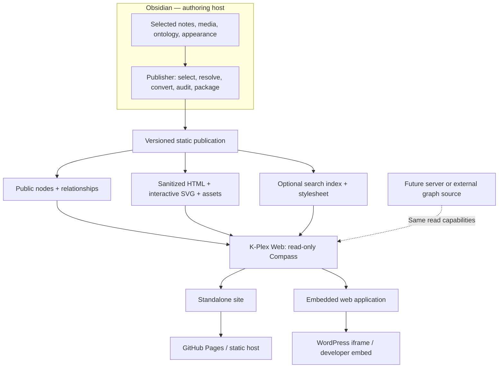
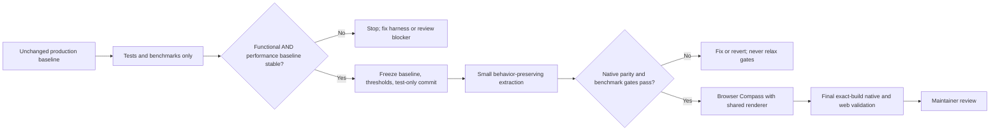
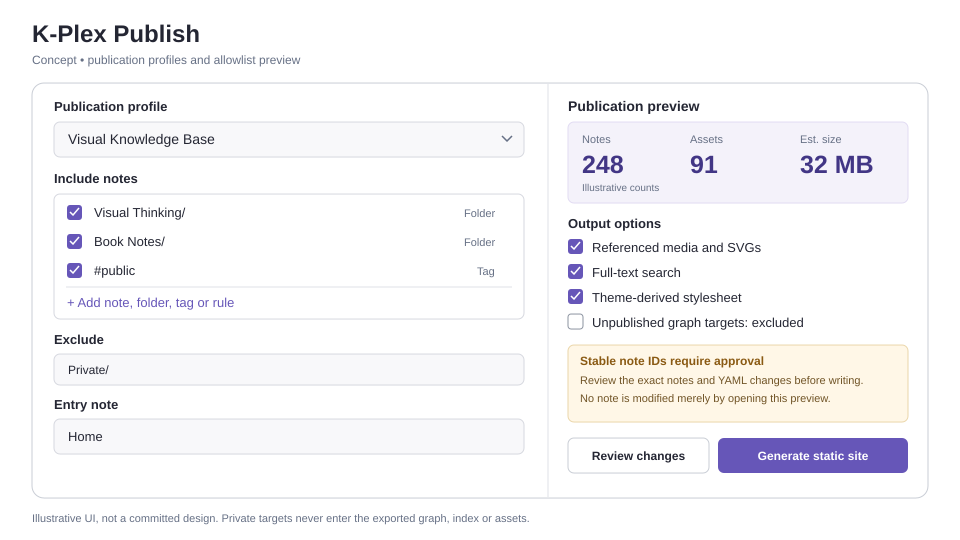
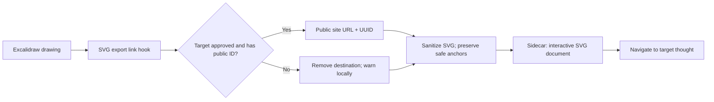
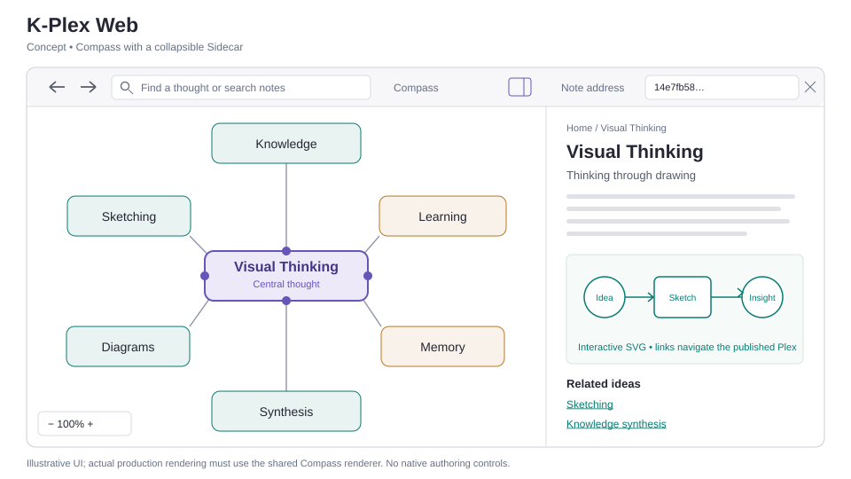
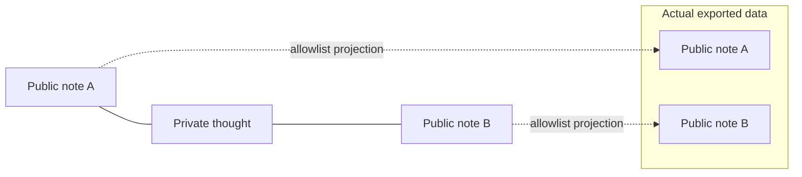

# K-Plex Web & Publish — independent visual knowledge navigation engine

**Proposal for discussion — November 27, 2026.** Prepared by Zsolt's Codex Agent from the maintainer's accepted product direction. The illustrations are concepts, not screenshots or implemented features.

## Vision

K-Plex should become an independent, general-purpose visual knowledge navigation engine, with Obsidian as its first authoring environment. Publishing is the first use case, not the definition of the product. The same portable format and renderer can eventually serve interactive book companions, enterprise architecture/knowledge portals, documentation, AI-generated maps, and dynamic knowledge graphs from other applications.

K-Plex Help is the natural first real publication: meaningful ontology, styled nodes, interconnected documentation, images and use cases. An enterprise knowledge base is a second motivating use case. The aspirational upper limit is a Jerry's Brain-scale graph (roughly 600,000 nodes), but that is expressly NOT an MVP target. The MVP serves targeted publications of hundreds to a few thousand nodes.

### Accepted product direction

- Static, read-only visual knowledge navigator, with no K-Plex-hosted publishing service and no server required.
- Compass in the browser MVP; Mind Map and Facets follow. Existing Obsidian views and behavior must not regress.
- Publish selected documents via explicit file/folder/tag rules and declarative lens predicates where supported, with manual additions/exclusions. No automatic graph-traversal inclusion in MVP.
- Unpublished graph nodes are **entirely absent**, not placeholders. Export only explicitly allowlisted presentation properties, public relationships and approved media.
- Persistent UUIDs in relevant Markdown notes, with explicit review/consent before any vault modifications. No silent bulk YAML changes.
- Portable K-Plex appearance and tools to derive an editable publication stylesheet from the user's current Obsidian theme. No arbitrary theme replication promise.
- Node/alias search and optional full-text search. Read-only Sidecar, address entry, shareable navigation URLs.
- Convert Markdown and Excalidraw drawings during export; SVG diagrams retain interactive links rewritten to public UUID destinations using Excalidraw's existing export link hook.
- Generate a static directory and provide upload instructions first. No automated host deployment in MVP.
- Full regeneration first; manifest and hashes prepare for future incremental updates. Removed content must be absent from the new local output.
- Open-source web runtime consistent with K-Plex's AGPL-3.0 licensing; user-authored content retains its own licensing.

## 1. Architecture: separate authoring from consumption



Three independently buildable/deliverable components, initially one source repository:

| Component | Ownership |
| --- | --- |
| Shared K-Plex Core and presentation | Existing graph/ontology semantics, projection, layout, predicates, node/gate/connector visual primitives, reusable measurement and interaction capabilities. One implementation, not a parallel web renderer. |
| K-Plex Web | Standalone browser runtime and eventually a reusable embeddable library; data provider, read-only Compass, navigation/history, search, Sidecar, responsive theme. No Obsidian/Electron dependency. |
| K-Plex Publish | Obsidian-side profile selection, complete scoped graph preparation, consent, media/content conversion, sanitization, preview and deterministic static packaging. |

The existing host-free `PlexViewRead` and `GraphNodeView` contracts are the strongest starting point. Browser data adapters should consume a versioned immutable publication, not a live Obsidian graph cache. Separate opaque runtime node identity, visual occurrence identity, semantic relationship roles and public UUID. Layout consumes resolved public relations; don't reimplement ontology classification in JS on the website.

Current C14 architecture has a portable semantic and view-policy boundary, not a portable application. The [architecture guide](https://github.com/zsviczian/kplex/blob/main/docs/ARCHITECTURE.md), [view API](https://github.com/zsviczian/kplex/blob/main/docs/CANVAS_VIEW_API.md), [view contracts](https://github.com/zsviczian/kplex/blob/main/src/core/plex/views/contracts.ts), [public API](https://github.com/zsviczian/kplex/blob/main/docs/PUBLIC_API.md), and [SearchBox](https://github.com/zsviczian/kplex/blob/main/src/ui/features/SearchBox.tsx) provide real seams. The current public API has bounded passive reads and coverage/revision stamps; it is neither a complete publication exporter nor a web service. Existing internal canvas registry is not a dynamic plugin loader.

Define a small versioned read contract with exact scope/completeness, nodes, adjacency, needed properties, presentation and note/asset addressing. Static data is the only first provider; avoid speculative generalization, but do not hardcode vault paths or synchronous whole-corpus availability into the portable API. Later a server can supply bounded asynchronous loads, access-controlled adjacency and search.

## 2. Regression safety: first and highest-risk feasibility gate

The native canvas is the most sensitive subsystem to change. Baseline source `270c2da3` has a roughly 6,390-line [PlexGraph.tsx](https://github.com/zsviczian/kplex/blob/270c2da3a0bd62f05815426cf4cd0a65ee82b160/src/ui/PlexGraph.tsx), plus host-related [ThoughtNode.tsx](https://github.com/zsviczian/kplex/blob/270c2da3a0bd62f05815426cf4cd0a65ee82b160/src/ui/ThoughtNode.tsx), native App/Sidecar, legacy GraphPage and scene DTOs. Extracting the whole canvas at once is unacceptable risk. No broad resume of paused C15–C26 refactoring.

| Area | Risk | Strategy |
| --- | --- | --- |
| Shared canvas orchestration, geometry, measurement, camera and gestures | Very high | Leaf-first extraction, parity on identical fixtures, exact-build native end-to-end tests |
| Node/gate/connector paint, images/icons and styles | High | Characterization at geometry, DOM, paint and input levels; narrow immutable presentation capabilities |
| Editor, Sidecar, authoring, native focus and lifecycle | High | Keep native orchestration and effects in Obsidian; test all existing interactions and rejected transitions |
| Graph reads and indexing | High | No new work on ordinary navigation; retain revision, source authority and coverage; never duplicate semantics |
| Existing Mind Map and Facets | High | Retest both even though browser MVP only includes Compass |
| Bundle size/build/scanner | Medium-high | Separate browser artifact, no duplicate runtime or opaque executable packaging |
| Browser shell/static data | Low relative to native | New isolated consumer, real browser tests |



The agent must prepare **self-validating unit/contract, real browser and native CLI test lanes before touching production rendering code**. Extend current tests, rather than invent a substitute host. Baseline must cover native Compass, Mind Map, Facets, crosslinks/gates, styles, camera, navigation, input, editing, Sidecar, popouts/multiple sessions, filters, export and index interaction. Use approved disposable vaults, real exact artifact hashes, identical data and settings, and existing CLI/browser harness helpers.

Performance is a first-class acceptance condition: paired baseline/candidate runs (A/A noise calibration and A/B/A or equivalent), small/dense/large fixtures, warm eager/on-demand and separate startup conditions, p50/p95 latency, meaningful tail/paint/frame evidence, CPU, memory, render/measure work, source acquisition/index work and leak checks. No new unexplained index work, extra measurement/render passes or reproducible performance degradation. Existing strict gates remain; any provisional noise/threshold allowance must be fixed BEFORE editing production. Do not lower standards to make candidate pass. If data is inadequate or comparison fails, stop; the maintainer decides any specific waiver.

See [PR #334 — regression-first portable Compass runtime](https://github.com/zsviczian/kplex/pull/334) and its [agent-ready specification](https://github.com/zsviczian/kplex/blob/2026-11-27-portable-web-runtime/docs/proposals/PORTABLE_WEB_RUNTIME_V1.md) for the required matrix, benchmarks and stop conditions.

## 3. Packaging and plugin size

The maintainer has identified a 5 MB plugin-size constraint; measure actual raw installed artifacts and verify applicable Obsidian submission limits before choosing the final packaging. Current installed size was not measured in this design review. The first PR must establish the size baseline and conservative budget, including deterministic release build and scanner/lint compliance.

- Use separate esbuild entry points for Obsidian and browser; shared source does not imply the browser bundle is embedded in the Obsidian artifact. Never ship a duplicate React/renderer bundle as part of the core plugin.
- Analyze esbuild metafiles, dependency duplication, tree shaking, dead code, optional feature boundaries, production minification, CSS/assets and actual artifact sizes. Do not remove functionality just to reach an arbitrary budget.
- Avoid pako or similar compression of executable internals followed by runtime unpacking/evaluation: even if compressed bytes are smaller, auditability and scanner trust matter. Do not use a remote executable loader in Obsidian. Normal web-host HTTP gzip/Brotli is a different matter.
- Keep the current deterministic Obsidian release build, scanner compliance and standard installable artifact contract.
- Publish the browser bundle as separately versioned transparent release artifacts and eventually an npm package, usable from jsDelivr/unpkg (other CDNs subject to their policies). Default generated sites ship a local, pinned runtime copy and CSS, compatible with the declared publication schema. A CDN is optional for embedders, not needed to read a publication.
- Decide integrated Publish feature versus a separate Obsidian publishing plugin after size feasibility. Initially one repository and logically separable publisher. If distribution of the browser bundle threatens the installed budget, use an explicitly obtained versioned local runtime package or a reviewed separate publisher/release strategy. A copied web asset must never be executed inside Obsidian merely to publish. Do not silently fetch executable code or depend on a live CDN to generate a working site. Exact UX and package verification remain open.

K-Plex's current [AGPL-3.0 license](https://github.com/zsviczian/kplex/blob/main/LICENSE) applies to distribution of the runtime and applicable corresponding source/notice obligations. Keep code licensing separate from user-published notes, media and any third-party assets/fonts; don't assert that publishing automatically changes their license.

## 4. Publication profiles and author workflow

A versioned JSON profile in a user-selected vault-owned configuration location (exact path/schema to be designed) stores a stable publication ID, title, selection rules and exceptions, entry note, export options, allowed properties, style configuration, search option and chosen destination settings. No credentials. Keep profile data local; do not dump it wholesale into the site. Multiple profiles can describe different subsets of the same vault.



1. Create or select profile; choose explicit notes, folders, tags and supported declarative predicates. Include/exclude manual selections with exclusions taking precedence. Reuse existing predicate semantics where feasible; unsupported/unknown conditions cannot silently include documents.
2. Resolve the exact proposed publication allowlist (including requested assets/embeds), choose a published entry note and produce a preview: notes, attachments, relationship counts, size estimate, invalid links, skipped dependencies and privacy warnings. Do not modify notes to preview.
3. Review any missing, invalid or duplicate UUIDs and precise proposed changes; ask explicit consent for frontmatter writes. Record changed/skipped/failed notes and revalidate the selection/identity after writes. If consent is declined and a stable identity is required, fail safely or offer explicit removal of affected notes; no silent ID creation.
4. Prepare coherent authoritative semantic data for the approved scope through existing index owners (on-demand/partial data cannot silently certify completeness). Project only allowed public nodes, relationships and properties. Preserve semantics and directions; recompute public neighbor counts and omit hidden/private evidence.
5. Convert selected content and media, build graph/search indexes and safe stylesheet, audit all output, stage a complete static directory and preview locally. No publishing/network upload without separate user action.
6. Generate or replace only the owned destination, with manifest and cleanup safety; provide steps for hosting. Re-running with the same public input yields the same public data and stable addresses; a new build must not leave removed notes/assets in the generated destination.

MVP: full regeneration, not automatic continuous sync. Staging and a validated manifest must prevent stale/private files remaining from an earlier export, accidental overwrite of arbitrary directories, partial-success publishing, or deletion of unrelated user files. Future incremental export uses content hashes and dependency tracking. Publishing is explicit, cancellable, bounded and preferably desktop-first; consuming the site should work on desktop and mobile browsers.

## 5. Public identity and navigation

Use a persistent note UUID, e.g. a configurable frontmatter property:

```yaml
---
kplex-id: 14e7fb58-1867-4fe9-a25c-648771c90a71
---
```

Distinguish internal graph NodeId (unchanged, opaque and case-sensitive), persistent note UUID (cross-platform identity), publication ID (site/collection identity) and visual occurrence IDs (never treated as canonical nodes). Publication IDs are scoped to the manifest. Use opaque stable public IDs for non-Markdown nodes (approved attachment/tag/folder/URL; no private vault paths). No path-hash fallback pretending to survive rename. Define stable registry lifecycle for non-note IDs and resolve copies/duplicates/templates without silently replacing existing valid UUIDs. Preview only writes for selected notes; no mass change elsewhere. Respect Obsidian's frontmatter API, active buffer/identity/revision and sync; handle partial consent/save failure, cancellation and duplicate IDs explicitly. Do not require UUIDs for private notes.

A web URL can be `https://example.com/knowledge/?node=14e7fb58-1867-4fe9-a25c-648771c90a71`; native history and deep links work under arbitrary static site base paths. Use encoded relative paths, validated destinations and collision-safe filenames. The ID is not a secret or an authorization mechanism. If a UUID no longer belongs to a publication, show an ordinary not-found state without revealing a private path.

Desktop deep linking is later, e.g. a proposed `obsidian://kplex?vault=MyVault&id=...` protocol handler. The web MVP never leaks a private vault name/path just to produce a native link. Define the local resolver and vault-selection UX in that follow-up PR; the URI is not an existing API.

## 6. Portable publication and content conversion

Illustrative directory structure (not a finalized wire contract):

```text
my-publication/
  index.html
  .nojekyll
  publication.json
  data/
    nodes.json
    relationships.json
    search-index.json
  notes/
    <uuid>.html
  assets/
    images/
    drawings/
    media/
  theme/
    publication.css
  runtime/
    kplex-web.js
    kplex-web.css
```

Manifest: schema and compatible runtime version, publication identity, entry UUID, safe relative resources, public feature flags and counts/hashes as needed. Validate bounds, references, graph consistency and version compatibility. Store resolved roles/direction, permitted public labels/aliases, safe presentation fields, and necessary public properties. No raw cache/evidence dump, credentials, private metadata, settings dump, paths or local file links. Chunking/worker providers are a scale-driven evolution, not mandatory for small MVP. HTML notes are separately fetchable; generate static sanitized HTML during publishing, not browser Markdown parsing. Independent HTML URLs and basic metadata leave room for SEO, but the visual navigator is the priority.

| Content | Direction |
| --- | --- |
| Markdown headings/lists/tables/callouts, links, aliases, code | Static HTML conversion with safe semantics and public link rewriting |
| Heading/block links | Preserve stable public fragment targets where supported; test collisions and unavailable targets |
| Embedded notes | Only allowed content; dependency closure and cycle/size guards, preview before adding |
| Images, PDF, audio/video | Browser-renderable approved assets; relative URLs and appropriate viewer/download fallback; no automatic arbitrary external fetch |
| Excalidraw | SVG export with rewritten interactive links, see below |
| Math/Mermaid | Prefer safe static rendering; define supported subset and fallback after feasibility |
| Dataview/Bases and arbitrary community plugin output | Not dynamic web dependencies; consider explicit, safe static result snapshots later |

Investigate public Obsidian Markdown rendering API and lifecycle versus a portable explicit renderer. Serializing arbitrary native/plugin DOM is not equivalent to portable HTML; native resource URLs, plugin postprocessors, external requests and CSS may leak private data or break. Do not blindly execute third-party processors; only admit deliberately supported conversion paths and sanitize output.

### Interactive Excalidraw SVG

Use the existing Excalidraw SVG export hook for modifying exported links (maintainer-confirmed capability; verify exact installed/public API signature and supported versions during implementation). Resolve authored links in context before conversion; rewrite approved internal note/drawing links to relative site URLs referencing exported UUIDs, preserving safe heading fragments. Unpublished/unresolved destinations must not remain as file paths, private IDs or active links. Preserve safe external links only under explicit policy. Missing optional Excalidraw integration must produce a clear warning/fallback, not break unrelated publications.



A plain HTML image element displays SVG as a noninteractive image. Use sanitized inline SVG (preferred for navigation interception and same-Plex history) or a carefully constrained document embedding strategy, not an unsanitized active object. [MDN SVG linking guidance](https://developer.mozilla.org/en-US/docs/Web/SVG/Guides/Linking). Remove script/event handlers, unsafe URL schemes, private paths, unapproved external references, dangerous active content, metadata and foreign content; preserve legitimate anchors, vector geometry, text, approved assets/fonts and styling. Test normal pointer/keyboard navigation, external URLs, nested transclusions, relative deployment base paths, malformed SVG and malicious payloads. An internal link to a public node should update the canvas and Sidecar, not open a clipped nested frame. Exported visual labels may themselves contain sensitive prose; preview and warn, rather than promising automatic semantic redaction of diagrams.

## 7. Appearance and reader experience



Read-only Compass, center activation, pan/zoom, browser back/forward, shareable UUID URLs, simplified Find/Search, and responsive Sidecar that can close/reopen and accept a published note's address or name. Internal note and diagram links recenter the graph; accessible keyboard/touch navigation and mobile canvas/reader layout. Only public nodes/links; no creation, editing, native commands or drag-to-author controls. Preserve the shared renderer, rather than reproducing Compass using a different algorithm.

Export resolved public K-Plex node and link styles, supported appearance profiles and a portable set of scoped CSS variables for background, text, accents, border, typography, link/graph styling and Markdown content. A theme capture/generator tool samples supported computed theme tokens from the current Obsidian environment and writes an editable, publication-scoped custom stylesheet. Prefer safe variable mapping and documented browser defaults, not copying all Obsidian theme/snippet code or assuming Obsidian DOM exists. Review both light/dark variants, missing fonts, custom theme fallback, accessibility/contrast, mobile sizes; don't expose private theme paths or arbitrary CSS URLs. Optional custom CSS is an intentional public asset and must be included in preview/audit. Fonts and images require appropriate redistribution permission.

## 8. Static search and scale

Two search modes:
- Find a thought: public titles/aliases, permitted tags/types, stable IDs and allowed display paths. Reuse the host-free SearchBox and a browser data provider with bounded results.
- Optional full-text search: compile an index of sanitized approved public text during publish, load lazily, show result snippets and navigate by UUID. Evaluate MiniSearch or equivalent based on size, performance, license, bundle cost, language/tokenization and build-time serialization; no dependency decision yet. No private text in an index, even if a result is visually hidden.

An in-memory public graph with adjacency lookups and bounded local layout is appropriate for a few thousand nodes; no full graph scan on every center change. Measure graph transfer/parse, initial interactive readiness, search initialization/query latency, navigation p95, memory and dense neighborhoods on representative desktop/mobile hardware. Separate lazy HTML/assets/search from graph startup. Do not target or advertise 600k-node performance in MVP. Large graphs later may need sharded adjacency, lazy metadata, Worker/off-main-thread search and server-side providers with bounded paging. A future server can improve search, authorization and dynamic data, but static MVP does not have selective access controls: every shipped file is readable. No K-Plex-hosted service commitment.

## 9. Hosting and embedding

| Destination | MVP approach |
| --- | --- |
| GitHub Pages | Generated directory in a site repository/branch or Pages workflow; include .nojekyll for plain-file publishing; verify non-root project paths |
| Netlify / Cloudflare Pages / conventional static hosting | Upload or deploy the generated directory, no build/server app required |
| WordPress / existing CMS | Host the site separately or under an accessible static path; embed via iframe if permitted by site configuration |
| Custom web application | Later documented mount/dispose/navigate API and downloadable or npm/CDN browser bundle |
| Node server | Later optional independently hosted provider; no service operated by K-Plex |

An iframe is an integration mechanism for WordPress/CMS and existing sites, not a requirement for standalone K-Plex Web. Same-origin deployment is simplest; cross-origin embeds need deliberate frame headers/CSP, sizing, accessibility and safe link/navigation policies. WordPress.com restrictions and self-hosted WordPress permissions differ. First provide clear upload/update instructions and a simple local HTTP preview; file:// is not assumed to support fetch. No tokens, credentials, Git writes or automated deployment in MVP.

Future developer API concept (not implemented):
```js
const plex = await mountKplex(element, {
  publication: "./publication.json",
  view: "compass",
  sidecar: true,
  search: true,
  theme: "auto"
});
plex.navigate("14e7fb58-1867-4fe9-a25c-648771c90a71");
```
Multiple instances and disposal are explicit. Package/API versions, schema compatibility, CORS, source notices and embedding CSS isolation are future integration acceptance requirements.

## 10. Privacy is an export boundary, not a display preference



Never synthesize an edge through a removed private note. Omit unpublished node names, aliases, paths, IDs, hidden fields, relationship definitions/evidence that are not approved, original degree counts and private tag/folder membership. Filter both endpoints, then derive counts, navigation and view scopes solely from the public graph. Publish no property value merely because it was present in a source record. No public manifest of excluded paths.

Audit every output channel: graph and search JSON, rendered HTML, inline/transcluded content, exported SVG anchors/metadata, assets and CSS URLs, generated file paths, indexes and manifests. Include adversarial fixtures that put unique private sentinel strings in those channels; fail the export when any forbidden sentinel leaks. External assets/embeds must be deliberate and disclosed; sanitize HTML/SVG, restrict protocols, disallow scripts and unsafe event attributes, validate generated paths and sizes. Use strict Content Security Policy where feasible. Exclusion does not magically redact sensitive plain text explicitly authored in a public note or drawn in a public diagram; the publisher must warn and let users review such content. Never upload automatically.

Publishing output is public by design; UUIDs are not authentication. Removing a note and republishing must remove it from new output, but cannot retract past downloads, caches, backups or public Git history. Provide clear instructions for removing stale files when uploading; local regeneration cannot guarantee remote deletion.

## 11. Implementation roadmap (tracking checklist)

- [ ] **PR 1 — Regression-first portable runtime:** [#334](https://github.com/zsviczian/kplex/pull/334) (draft specification, not implemented). Benchmark and characterize unchanged desktop before any production edits; share the minimum renderer boundary; browser Compass on synthetic data; no web runtime inside desktop, no regressions. Feasibility gate for later work.
- [ ] **PR 2 — Publication engine:** versioned public schema and profile/selection model; explicit UUID consent and safe writes, authoritative scoped export and privacy gates, HTML/interactive SVG and media, full static packaging and removal/manifest semantics. Integrate a browser-compatible local graph provider. Establish safe output and representative K-Plex Help fixture.
- [ ] **PR 3 — Publishing experience:** publication profile UX, selection/allowlist preview and consent, search, appearance/theme CSS generation, local preview and republish workflow, upload instructions, real K-Plex Help publication in approved destination, accessibility/mobile browsing and scale tests.
- [ ] **PR 4 — Web integrations:** embeddable mount API, versioned downloadable/npm bundle and CDN documentation, WordPress/iframe examples, then additional native view definitions (Mind Map and Facets) as supported by public capabilities. Split additional views into their own PRs if regression/scope warrants.
- [ ] **PR 5 — Desktop deep links:** UUID resolution and local Obsidian protocol handling with explicit vault selection/identity rules, rename and duplicate resolution tests; no public private vault paths.

Order may refine after feasibility; PRs 2–5 are not yet created. The first PR is a spec-only draft; all boxes remain unchecked until implementation and acceptance. A future authenticated/dynamic server or 600k-node scale work is not part of these MVP PRs.

## 12. Complexity, open implementation decisions and acceptance

Earlier static assessment was roughly 22–42 focused developer-days for a production MVP; the now-explicit native regression-first test/benchmark phase increases uncertainty and effort. A preliminary planning range is roughly 30–55 developer-days (not a schedule or measured estimate), with PR 1 itself possibly 8–18 days including baseline and extraction feasibility. Actual effort should be re-estimated after measuring the existing test coverage, bundle size and safe renderer seam. A browser proof of concept is not a production release. Avoid spending weeks on general refactoring if a minimal shared leaf-component extraction provides parity.

Open implementation decisions, subject to evidence rather than new product scope:
- Integrated/separate publisher and transparent distribution of pinned browser assets within the actual size budget.
- Exact publication profile location/schema, UUID field/registry collision and denied-consent UX, coherent graph-read mechanism and static routing/versioning.
- Supported Markdown converter/processor boundaries, exact Excalidraw hook contract and safe interactive SVG implementation.
- Search library/index format, theme token generator, staged destination ownership and privacy audit.
- Measured performance budgets for a few thousand nodes and eventual provider evolution.

Release acceptance for MVP: selected public knowledge from a real approved fixture appears with correct semantic roles, visuals, UUID navigation and interactive SVG; mobile/desktop browser behavior and GitHub Pages project path work; no private sentinel leaks, stale content or unconsented vault writes; package/scanner requirements met; exact-build native rendering/function/performance regressions absent. The existing product must remain fully usable when publishing is not installed or not in use.

**This is a proposed roadmap, not a release announcement.** No code, benchmark or browser prototype has been delivered at this specification stage; the maintainer's product decisions are reflected above. The first PR establishes the implementation and validation gate.
