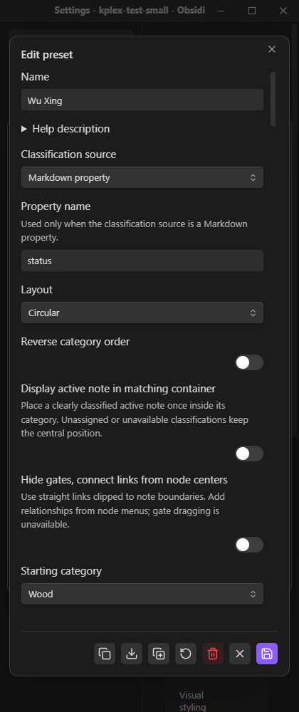
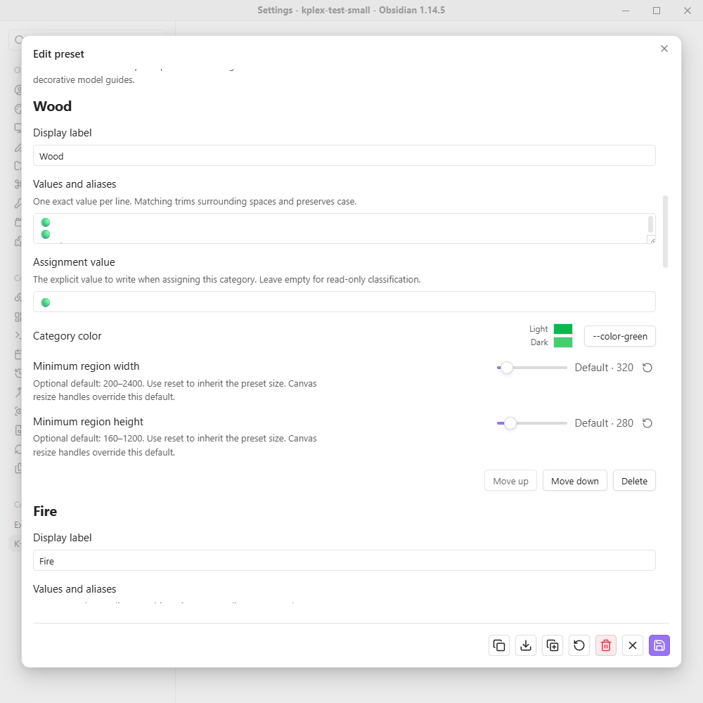
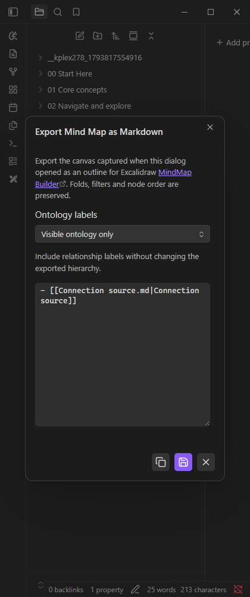

# Authoring UI and template follow-up — PR #278

Changes remain uncommitted on `2026-11-03-issue-277-creation-links-compass`, base `c0e6166`. No commit, push, merge, release, issue closure or PR edit performed. [Machine-readable receipts](authoring-ui-templates-278-2026-11-04.json) retain exact artifacts, source inventory and native cleanup.

## Delivered behavior

- Facets preset editor uses the shared native options layout and footer. Classification source has separation below Help. Dropdowns align; color preview and its source action occupy one native control column on the right. Footer glyphs are centered. Shared color consumers inherit the same correction.
- Native forms use actual Obsidian Setting/input/dropdown/button structure. K-Plex adds layout rather than its own control skin. [UI_RULES](../../UI_RULES.md) records mandatory shared owners and mobile/native-shell constraints.
- Connection property selection reuses the relationship picker, with description beneath the field name, visible create/edit glyphs, explicit vocabulary creation and clearer additive relationship wording.
- Markdown export gives the ontology selector remaining row width, keeps native help typography and uses centered shared footer icon actions. The narrow footer fits without clipping.
- Today pin hides custom Folder/Date format when Daily Notes configuration is selected, retaining saved values and destination preview.
- All K-Plex creation paths await the actual Templater creation promise before metadata writes/reveal. Folder/regex matching and YAML/body execution remain Templater-owned. Recovery follows exact file identity and cannot bypass missing/failed template receipts. Unload restores interception and cancels K-Plex waits. See [integration contract](../TEMPLATE_CREATION.md).
- Foreign template execution no longer holds mutation priority: navigation and indexing can advance while a template is suspended. Metadata writes and publication retain mutation priority after completion.

## Actual validation

Node 22.22.2; Windows Obsidian 1.14.5. Installed-type production build, portable type compilation and source lint passed. Architecture: 263 roots, 466 reachable files, zero violations; numeric controls: 211 sources, shared owners only.

423 focused tests passed, zero failed/skipped: 93 UI/browser/automation-adapter cases; 242 creation/relationship/periodic/import/export/UI/localization contracts; 88 priority/event-convergence cases. The scheduler command was:

`node --test --test-concurrency=1 tests/foreground-work-scheduler.test.mjs tests/source-priority-indexeddb.test.mjs tests/source-event-convergence-indexeddb.test.mjs tests/foreground-startup-indexeddb.test.mjs`

The new priority regressions first failed with a held P0 mutation scope, then passed after moving template waits outside that scope. The full expensive indexing aggregate was intentionally not rerun for this follow-up; previous aggregate results apply only to their recorded artifacts.

Exact final-build native lanes passed serially under the shared application lock in disposable Small: template-lifecycle, ontology-export, pin-settings, controls and preset-ui. Each restored configuration/enablement bytes, layout and fixture baseline (117 files / 98 Markdown). No production template or notes were edited.

Actual Templater 2.26.0 executed folder, regex and configured core Daily Notes templates. Suspended YAML commands demonstrated no premature K-Plex property writes; the inverse relationship appended into the same template property without losing its existing values. P1 navigation and P4 background checkpoints advanced during suspension. Handler restored; zero additional full semantic builds. Temporary Templater executable/configuration was removed/restored by staging cleanup.

UI lanes exercised actual native light/wide and dark/narrow windows, including connected Settings. Controls were compared with core Obsidian controls. Selected real renderer captures:

## Limits and residual risk

One earlier repeated preset staging run timed out while enabling K-Plex; Small's renderer was confirmed crashed. Cause remains unknown. Only that disposable renderer was reloaded, using an independent test-vault CLI. Production windows were untouched; no whole-application restart. The same preset run passed twice afterward and again against final artifacts; recovery observer recorded no further exits and was removed. Configuration bytes/layout/fixture baseline were restored. This recovery does not establish that the original crash was fixed.

Mac and physical on-screen keyboard acceptance remain pending. Narrow desktop screenshots establish layout, not mobile keyboard behavior or production navigation performance. Templater integration uses a guarded unpublished handler (validated 2.26.0); an unsupported enabled integration fails safely rather than racing template YAML. Never-settling scripts remain pending with a waiting notice. Arbitrary later timers/global active-editor commands still need explicit view targeting; the production DNP template was not modified. The [targeted example](../snippets/daily-note-excalidraw-view.md) addresses that separate concern.

The [production index recovery observation](index-recovery-observation-2026-11-04.md) remains unresolved. This work adds diagnostics and protects template-wait priority; it does not claim a general fix for unexpected full rebuilds.

## Review checks

1. On Mac, inspect preset options/colors and export in the user's theme: aligned controls, centered glyphs and no clipping.
2. Exercise the full personal DNP template in a Sidecar with a file-targeted conversion command; verify template YAML and body before any inverse relationship write.
3. On a physical phone/tablet, type in a lower modal field with the keyboard visible; scroll to the edit area and footer without obstruction.

## Deployment

The tested main.js/styles.css were deployed to Zsolt's Brain at 2026-11-04T18:45:24.2621248Z; copied hashes match the exact native artifacts above. Existing executables were backed up under the workspace. Manifest unchanged; no plugin reload, notes, templates, settings or workspace writes. This permits Sync to the user's Mac; it does not establish that the Mac has loaded the new build. The machine-readable record retains the deployment receipt and backup path.
